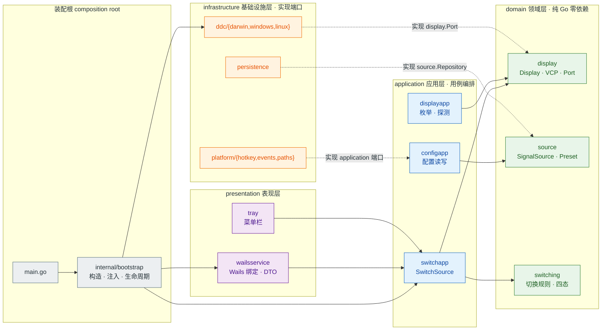
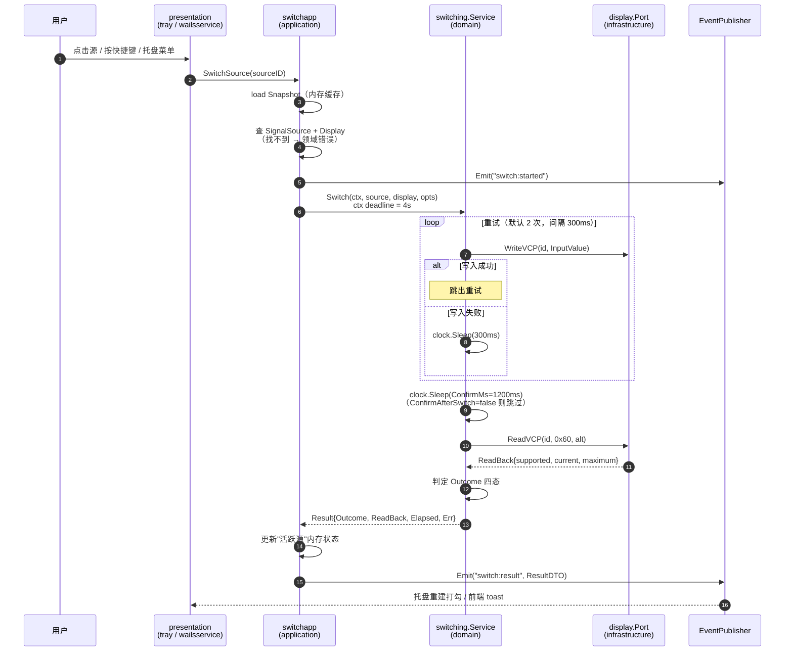
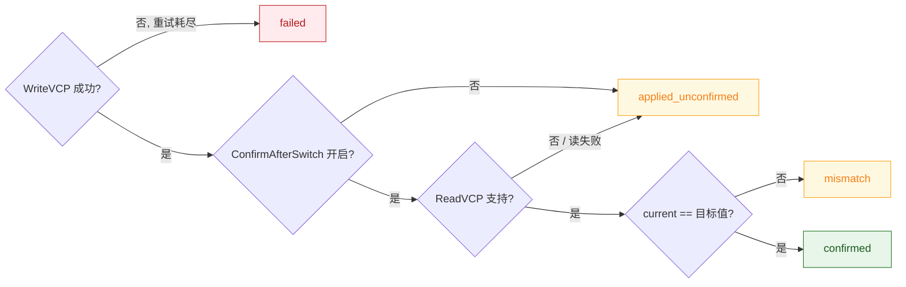
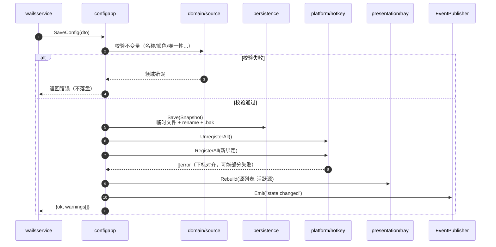
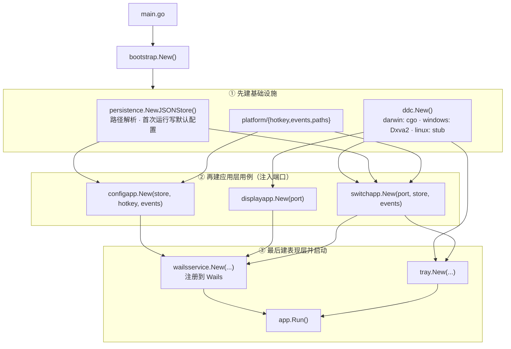

# Switch Display — 架构说明（Living Document）

> **本文件是"活文档"**：架构的**唯一事实来源**。需求新增/修改、包结构调整、接口变更、新增依赖，
> 都必须在同一次改动里同步本文件（见 §12 文档维护约定 + §13 变更日志）。
>
> 状态：**设计基线**，代码尚未开始实现（`main.go` 等仍是 Wails 模板）。
> 每个模块实现后，把 §4 表格里对应行的「状态」改成 ✅。
>
> 需求文档：[plan.md](plan.md) · 文档索引：[README.md](README.md)

---

## 1. 架构风格与选型理由

**DDD（领域驱动设计）+ 整洁架构（Clean / Hexagonal）**，四层 + 一个装配根：

- 依赖方向单向向内：`presentation → application → domain`，`infrastructure → domain`（实现端口）。
- `domain` 零外部依赖（不 import Wails、不 import cgo、不 import 任何第三方库，只有标准库）。
- 平台相关能力（DDC/CI、Wails 事件、全局快捷键、文件路径）全部收敛在 `infrastructure`，以**端口接口**注入。
- `main.go` 是**唯一的装配根（composition root）**：只做实例化 + 注入 + 启动，不含业务逻辑。

为什么不用单包 / 扁平 `internal/`：本项目跨 3 个平台各有 DDC 实现、还要接托盘、快捷键、配置持久化、前端绑定。
按层切开后，**新增一个平台 = 加一个目录 + 改一处工厂**，不需要碰领域逻辑；也让 `domain` 可以纯 Go 单测（无 cgo、无 GUI）。

依赖规则用 Mermaid 图表达，便于随代码演进增量修改（§2）；相关决策见 §10 的 ADR。

---

## 2. 分层与依赖规则

> 本节所有图表使用 **Mermaid** 语法（GitHub / VS Code / JetBrains 可直接渲染），
> 不使用字符画——改结构时只改节点与边，不重排对齐。
> 本机预览：VS Code 装内置的 Markdown Preview Mermaid Support，或 `npx @mermaid-js/mermaid-cli -i x.mmd -o x.png`。



**依赖方向（向内）**：`presentation → application → domain`，`infrastructure → domain`。
`infrastructure` 只允许 import `application/port.go`（端口与数据类型）去实现端口，**从不** import 用例包或 `presentation`
（见 R3）；**虚线 = 实现端口**，**实线 = 调用/注入**。只有 `main.go` / `bootstrap` 连所有层（R5）。

| 规则 | 说明 |
|---|---|
| R1 | `domain` 只能 import 标准库。**禁止** import Wails、cgo、`internal/application`、`internal/infrastructure`、`internal/presentation`。 |
| R2 | `application` 只能 import `domain` + 标准库 + 自己声明的端口（`application/port.go`）。**禁止** import `infrastructure` / `presentation` / Wails。 |
| R3 | `infrastructure` 可以 import `domain`（实现其接口）；**允许** import `application/port.go` 里的端口与数据类型（实现 `HotkeyRegistrar` / `EventPublisher` 所需），但**禁止** import 任何 `application/*app` 用例包与 `presentation`。 |
| R4 | `presentation` 可以 import `application` + `domain`（只读 DTO/值对象），**禁止** 直接 import `infrastructure`。 |
| R5 | 只有 `main.go` / `internal/bootstrap` 可以同时 import 所有层。 |
| R6 | cgo 只允许出现在 `internal/infrastructure/ddc/darwin/`。其它包不得出现 `import "C"`。 |
| R7 | 跨平台差异只允许通过 **build tag 文件**（`//go:build darwin` / `windows` / `linux`）或同签名的多文件实现表达，不能用运行时 `runtime.GOOS` 分支散落各处。 |
| R8 | 层的边界用**接口**（端口）表达，接口定义在**使用方**（domain 定义它需要的端口），实现在基础设施层。 |

---

## 3. 目录结构（目标形态）

> 目录结构用 ASCII 树（改起来直观）；**流程图/时序图仍用 Mermaid**（§2、§7）。

```
switch_display/
├── main.go                          # 装配根：建 Wails 应用、装 bootstrap、注册服务、app.Run()
├── internal/
│   ├── bootstrap/
│   │   ├── bootstrap.go             # Build(wailsApp) *App / (*App).Start(ctx) / AttachWindow
│   │   └── bootstrap_test.go        # 装配完整性 + 取消的 context 快速失败
│   │   （e2e_manual_test.go 带 //go:build manual，真机跑一次真实切换）
│   │
│   ├── domain/                      # ── 领域层（纯 Go，只 import 标准库） ──
│   │   ├── display/
│   │   │   ├── display.go           # Display 聚合根、DisplayID、Label()
│   │   │   ├── input.go             # InputValue / VCPCode / ReadBack 值对象
│   │   │   ├── port.go              # Port 接口（List/ReadVCP/WriteVCP）← infrastructure 实现
│   │   │   └── errors.go            # ErrDisplayNotFound / ErrUnsupported / ErrWriteFailed
│   │   ├── source/
│   │   │   ├── source.go            # SignalSource 聚合根 + 不变量（New/Validate/Rename）
│   │   │   ├── preset.go            # 输入口预设表（DP1=15 … LG alt 表）+ MatchPreset
│   │   │   └── repository.go        # Repository 接口 + Snapshot / Settings + Snapshot.Validate
│   │   └── switching/
│   │       └── service.go           # 领域服务：Outcome 四态 + Clock + Switch（写-等-读-判定）
│   │
│   ├── application/                 # ── 应用层（用例 / 编排） ──
│   │   ├── port.go                  # EventPublisher / HotkeyRegistrar / Clock / Logger + 事件名
│   │   ├── switchapp/service.go     # SwitchByID 用例（串行化、事件广播）
│   │   ├── switchapp/service_test.go
│   │   ├── configapp/service.go     # Load / Save / Export / Import / RebindHotkeys
│   │   ├── configapp/service_test.go
│   │   ├── displayapp/service.go    # Refresh / List / Probe + Watcher（热插拔轮询）
│   │   ├── displayapp/service_test.go
│   │   └── dto/
│   │       ├── dto.go               # 面向前端的扁平 DTO
│   │       ├── convert.go           # 领域 ↔ DTO 双向映射
│   │       └── convert_test.go
│   │
│   ├── infrastructure/              # ── 基础设施层（实现端口） ──
│   │   ├── ddc/
│   │   │   ├── ddc.go               # New() display.Port（平台无关签名）
│   │   │   ├── new_darwin.go        # //go:build darwin && cgo → darwin.New()
│   │   │   ├── new_windows.go       # //go:build windows → windows.New()
│   │   │   ├── new_linux.go         # //go:build linux → linux.New()
│   │   │   ├── darwin/
│   │   │   │   ├── darwin.go        # cgo 声明 + Port 实现（唯一 import "C" 的地方）
│   │   │   │   ├── i2c.h / i2c.m    # IOAVServiceRead/WriteI2C、DDC/CI 帧拼装
│   │   │   │   ├── registry.h/.m    # IORegistry 枚举 DCPAVServiceProxy / 匹配 framebuffer
│   │   │   │   ├── port_test.go     # 烟雾测试（枚举/读回不崩，需真显示器）
│   │   │   │   └── branches_test.go # 取消/未知显示器/不支持 等不碰硬件的分支
│   │   │   ├── windows/
│   │   │   │   ├── port.go          # display.Port 实现：枚举 → 匹配 ID → Dxva2 读写（1 个 Mutex 串行化）
│   │   │   │   ├── win32.go         # user32/dxva2 薄封装（EnumDisplayMonitors / PHYSICAL_MONITOR / VCP / 注册表 EDID）
│   │   │   │   ├── edid.go          # 纯函数 EDID 解析（厂商码/产品码/序列号/描述符名）
│   │   │   │   └── port_test.go     # 结构体布局 + deviceInstance + EDID 解析 + Alt 不支持（不碰硬件）
│   │   │   └── linux/stub.go        # 返回 display.ErrUnsupported（后续 i2c-dev）
│   │   ├── persistence/
│   │   │   ├── jsonstore.go         # source.Repository 实现：原子写 + .bak + fsync + 导入导出
│   │   │   ├── migrate.go           # 配置版本迁移 + 默认值补齐
│   │   │   ├── paths.go             # os.UserConfigDir()/switch-display/config.json
│   │   │   ├── jsonstore_test.go    # 往返/备份/坏文件/导入导出
│   │   │   └── migrate_test.go      # 版本迁移 + 默认值 + context 取消
│   │   └── platform/                # 端口 → Wails/系统 的薄转发
│   │       ├── events.go            # EventPublisher → Wails app.Event.Emit
│   │       ├── hotkey.go            # HotkeyRegistrar → Wails GlobalShortcut
│   │       ├── clock.go             # Clock → time.Now / 可取消 timer
│   │       ├── logging.go           # Logger → log/slog
│   │       ├── errors.go
│   │       ├── platform_test.go      # Logger / Clock / 错误文案
│   │       └── hotkey_test.go        # 无 Wails 运行时时的降级分支
│   │
│   ├── presentation/                # ── 表现层（Wails 绑定 + 托盘） ──
│   │   ├── wailsservice/
│   │   │   ├── service.go           # DisplayService：薄适配，只做 DTO 映射与启动钩子
│   │   │   ├── errors.go            # 领域错误 → 稳定 error code（前端 i18n 用）
│   │   │   ├── service_test.go      # 端到端接线（fake Port + 临时配置目录）
│   │   │   ├── service_extra_test.go# 警告一次性消费 / 导入导出 / 错误映射
│   │   │   └── errors_test.go       # 错误码映射表（对外契约）
│   │   └── tray/
│   │       ├── tray.go              # SystemTray：菜单全量重建、打勾、点击转发、关窗隐藏
│   │       ├── labels.go            # 托盘菜单文案（原生菜单拿不到 vue-i18n，自己一份）
│   │       ├── icon_darwin.go       # macOS：SetTemplateIcon（按菜单栏明暗自动反色）
│   │       ├── icon_desktop.go      # Windows/Linux：SetIcon + SetDarkModeIcon（Wails 的 SetTemplateIcon 在这两个平台是空实现）
│   │       ├── self_darwin.go       # 英文文案里的本机说法 "This Mac"
│   │       ├── self_other.go        # Windows/Linux 用 "This PC"
│   │       ├── assets/icon.png      # 44×44 黑/透明图形（go:embed）
│   │       ├── assets/icon-white.png# 同形状的白色版，给深色任务栏用
│   │       ├── tray_test.go         # 菜单结构（顺序/Radio/打勾/禁用/语言）
│   │       ├── switch_test.go       # busy 串行、失败不挪打勾、读回纠正打勾
│   │       └── labels_test.go       # 中英文案 + 区域兜底
│   │
│   └── (已删除) greetservice.go
│
├── frontend/                        # Vue 3 + TS + Tailwind v4 + shadcn-vue 风格组件 + Pinia + vue-i18n
│   └── src/
│       ├── api/index.ts             # 包一层 bindings：组件不直接调 $Call
│       ├── stores/app.ts            # Pinia：显示器 + 信号源 + 设置（单一 store）
│       ├── router/index.ts          # hash 路由：/ /sources /settings（ADR-006）
│       ├── App.vue                  # 左侧可折叠导航栏（宽度持久化到 localStorage）+ RouterView
│       ├── views/
│       │   ├── SwitcherView.vue     # 切换台：点卡片即切
│       │   ├── SourcesView.vue      # 信号源增删改 + 快捷键录制（整体提交）
│       │   └── SettingsView.vue     # 语言 / 关窗隐藏 / 读回确认 / 本机源 / 导入导出
│       ├── components/
│       │   ├── PageShell.vue         # 页面骨架：标题 + 说明 + 右上操作区（三页统一起点）
│       │   ├── SettingRow.vue        # 设置项行：左标题/说明 + 右控件（对齐由结构保证）
│       │   ├── SourceCard.vue        # 切换台的信号源卡片（当前态/结果徽标/切换按钮）
│       │   ├── SourceEditor.vue      # 新增与编辑共用表单（两列网格 + 快捷键录制）
│       │   └── ui/                   # 手写 shadcn 风格原子组件
│       │       ├── Button.vue        # cva：default/secondary/outline/ghost/destructive
│       │       ├── Card.vue
│       │       ├── Input.vue
│       │       ├── Label.vue
│       │       ├── Select.vue        # 原生 select 封装
│       │       ├── Checkbox.vue      # 原生 checkbox + defineModel<boolean>
│       │       ├── Badge.vue         # cva：default/secondary/outline/success/warning/danger
│       │       └── Field.vue         # 表单字段：label + 控件 + hint（垂直节奏统一）
│       ├── locales/                 # i18n 骨架（en / zh-CN）
│       └── lib/
│           ├── utils.ts             # cn()
│           ├── theme.ts             # 跟随系统 light/dark
│           └── accelerator.ts       # KeyboardEvent.code → accelerator 字符串 + ⌘⌥1 显示
└── docs/
    ├── plan.md                      # 需求与实施方案（会随需求演进）
    ├── architecture.md              # ← 本文件：架构唯一事实来源
    └── README.md                    # 文档索引 + 维护约定
```

---

## 4. 各层职责（含实现状态）

| 层 | 职责 | 明确不做 | 状态 |
|---|---|---|---|
| `domain/display` | 显示器身份（稳定 ID）、输入源值对象、VCP 读写**端口**、领域错误 | 不知道 cgo / IORegistry / 前端 | ✅ 第一步 |
| `domain/source` | 信号源聚合与不变量、端口预设、持久化**端口** | 不读文件、不注册快捷键 | ✅ 第一步 |
| `domain/switching` | 切换的**规则**：重试次数、确认窗口、结果四态判定 | 不 sleep、不写 I2C、不发事件（通过注入的 Clock/Port） | ✅ 第一步 |
| `application` | 用例编排与事务边界（一次保存 = 一次完整持久化 + 快捷键重建）、DTO 组装 | 不含业务规则判定 | ✅ 第一步 |
| `infrastructure/ddc` | 用 macOS IOKit/IOAVService、Windows Dxva2 真正读写 DDC/CI；Linux 桩 | 不决定"切哪个源" | ✅ darwin + windows / ⬜ linux 桩已就位 |
| `infrastructure/persistence` | JSON 文件读写、原子替换、备份、版本迁移、路径解析 | 不校验业务规则（交由 domain） | ✅ 第一步 |
| `infrastructure/platform` | Wails 事件/全局快捷键/时钟/日志 | 不含菜单结构定义 | ✅ 第一步 |
| `presentation/wailsservice` | 暴露给前端的 API、DTO 映射、错误 code | 不含流程控制 | ✅ 第一步 |
| `presentation/tray` | 菜单结构、图标、当前源打勾、点击转发、关窗隐藏 | 不直接调 ddc | ✅ 第二步 / Windows 图标与文案已适配 |
| `bootstrap` | 装配、生命周期、热插拔轮询、关窗拦截接线 | 不写业务分支 | ✅ 第二步 |

---

## 5. 关键接口契约

> 接口定义在使用方；下面的签名是**契约**，改动必须同步本文件并记入 §13 变更日志。

```go
// ── internal/domain/display/port.go ──────────────────────────────
type DisplayID string // macOS: System UUID；Windows: monitor device path；Linux: connector+EDID hash

type Port interface {
    List(ctx context.Context) ([]Display, error)
    ReadVCP(ctx context.Context, id DisplayID, vcp VCPCode, alt bool) (ReadBack, error)
    WriteVCP(ctx context.Context, id DisplayID, v InputValue) error
}

// ── internal/domain/display/input.go ─────────────────────────────
type VCPCode byte // 0x60 = Input Source, 0xF4 = LG alternate

type InputValue struct {
    VCP   VCPCode
    Value uint16
    Alt   bool // true → chip addr 0x50 / VCP 0xF4
}

type ReadBack struct {
    Supported bool   // 显示器是否真的支持读该 VCP
    Current   uint16
    Maximum   uint16
    Raw       []byte // 诊断用原始帧
}

// ── internal/domain/source/repository.go ─────────────────────────
type Repository interface {
    Load(ctx context.Context) (Snapshot, error)
    Save(ctx context.Context, s Snapshot) error
    Path() string // 供 UI 展示「配置在哪」，也便于「打开目录」类功能
}

type Snapshot struct {
    Version  int
    Settings Settings
    Sources  []SignalSource
}

// ── internal/application/port.go ─────────────────────────────────
type EventPublisher interface{ Emit(name string, payload any) }
type HotkeyRegistrar interface {
    RegisterAll(bindings []Binding) []error // 部分失败：下标对应
    UnregisterAll()
}
type Clock interface {
    Now() time.Time
    Sleep(ctx context.Context, d time.Duration) error
}
type Logger interface{ Debug(msg string, kv ...any); Info(msg string, kv ...any); Error(msg string, err error, kv ...any) }

// ── 常量（internal/application/port.go）───────────────────────────
const (
    EventSwitchStarted  = "switch:started"
    EventSwitchFinished = "switch:finished"
    EventStateChanged   = "state:changed"
    EventOpenSettings   = "dialogs:open-settings"  // 托盘「设置…」→ 前端跳设置页
    EventShowView       = "ui:show-view"           // payload: 目标路由路径
)
```

**配置结构（磁盘格式，`Snapshot` 的 wire 形态）**：

```jsonc
{
  "version": 1,
  "settings": { "language": "", "confirmAfterSwitch": true, "defaultConfirmMs": 1200,
                "hideToTrayOnClose": true, "selfSourceId": "" },
  "sources": [
    { "id": "src-1a2b3c4d", "name": "工作 PC", "color": "#3b82f6",
      "displayId": "7E4E3972-…", "input": { "vcp": 96, "value": 17, "alt": false },
      "shortcut": "", "confirmMs": 1200 }
  ]
}
```

**显示器不进配置文件**：`Display` 是宿主机的硬件快照，换一台显示器后 UUID 会变，
存进配置只会让「换显示器」变成一次配置迁移。`Source` 只存 `displayId` 引用。

`Clock` 是为了让"重试间隔/确认窗口"在单测里不真 sleep（测试用 fake clock 立即推进）。

---

## 6. 领域模型要点

**聚合**：`SignalSource`（改名的边界）、`Display`（只读快照，来自端口枚举）。

**值对象**：`DisplayID`、`InputValue`、`Accelerator`、`VCPCode`、`ReadBack`。

**不变量**（在 domain 内强制，构造/变更时校验，返回领域错误）：

| 对象 | 不变量 |
|---|---|
| `SignalSource` | `Name` trim 后非空、≤32 字符；`Color` 匹配 `^#[0-9a-fA-F]{6}$`；`ConfirmMs ∈ [0, 10000]`（0 = 不确认） |
| `Snapshot` | `Shortcut` 跨源唯一（空串不算）；`(DisplayID, VCP, Value, Alt)` 组合唯一（防止两个源抢同一个口）；`SelfSourceID` 非空时必须指向已存在的源；`Version ≥ 1` |
| `SignalSource` | 引用的 `DisplayID` 必须来自当前枚举结果（保存时由 application 校验，不在 domain 内查硬件） |

**领域服务** `switching.Service`：
- 输入：`SignalSource` + 目标 `Display` + `Options{Retries, ConfirmWindow, Timeout}`
- 输出：`Result{SourceID, Outcome, ReadBack, Elapsed, Err}`
- `Outcome` 四态：`confirmed`（读回等于目标）/ `mismatch`（读回不等于）/ `applied_unconfirmed`（读不支持，视作已发送）/ `failed`（写失败且重试耗尽）

> 为什么要四态：本机实测该显示器 **VCP 0x60 读回不可信**（返回 cur=18 max=14），
> 所以不能把"读不到"当成失败。

---

## 7. 关键流程

### 7.1 切换（点击 / 快捷键 / 托盘都走这一条）



**Outcome 判定**



| Outcome | 用户文案 | 托盘 / UI 表现 |
|---|---|---|
| `confirmed` | 已切换到「X」 | 目标源打勾 + 高亮 |
| `mismatch` | 已发送，但显示器回报输入口为 N，可能未生效 | 提示 + 保留上次活跃态 |
| `applied_unconfirmed` | 已发送（该显示器不支持读回，无法确认） | 目标源打勾 + 「未确认」角标 |
| `failed` | 切换失败：<原因> | 错误 toast，回退到上次活跃态 |

### 7.2 保存配置（一次保存要做的事，必须原子感）



若第 3 步部分失败：配置**仍然保存**（用户意图生效），但返回 `warnings` 让 UI 标红对应行。**不回滚**——理由：快捷键被占用不该让用户的配置丢失。

### 7.3 启动装配



---

## 8. 扩展指引（"方便扩展"的具体落点）

| 想加什么 | 要动哪里 | 不用动什么 |
|---|---|---|
| **真正的 Windows DDC** | ✅ 已落地：`infrastructure/ddc/windows/{port,win32,edid}.go`，保持 `display.Port` 签名 | domain / application / 前端 |
| **真正的 Linux DDC** | 同上（`/dev/i2c-*` 或 `ddcutil` 包装）；`linux/stub.go` 换成同构实现即可 | 同上 |
| **亮度/对比度页** | `domain/display` 已有 VCP 值对象 → `displayapp` 加 ReadVCP/WriteVCP 用例 → `wailsservice` 暴露 → 前端加页 | 切换逻辑 |
| **多显示器矩阵** | `Snapshot` 已有 `Displays[]`；`switching` 增加"组"的概念（新聚合 `SourceGroup`） | ddc 层 |
| **新的输入源预设（投影仪/AV 功放）** | 只在 `domain/source/preset.go` 加表项 | 其它 |
| **新事件** | `application` 里 Emit + `docs/architecture.md` 事件表 + 前端 `api/events.ts` | — |
| **加 i18n** | 前端 `lib/i18n`；后端错误码→文案在 `presentation/wailsservice/errors.go` | domain |

**新增模块的判定口诀**：只要它"知道真实世界的一个规则"，进 `domain`；只要它"和外部世界对话"，进 `infrastructure`；只要它"编排步骤"，进 `application`；只要它"给用户看/给前端用"，进 `presentation`。

---

## 9. 跨层约定

- **错误**：domain 只返回**哨兵错误**（`errors.Is` 可判），用 `fmt.Errorf("…: %w", err)` 包装保留链；`presentation` 负责翻译成中文用户文案（`errors.go` 一张表）。禁止在 domain 里拼用户可见文案。
- **context**：所有可能阻塞的端口方法都收 `ctx`；统一起点 4s（写/读），由 `application` 设 deadline。
- **并发**：`Snapshot` 由 `configapp` 用 `sync.RWMutex` 保护；DDC 读写**串行化**（一个 `sync.Mutex` 在 ddc 实现内，因为 I2C 通道不并发安全）。切换操作加"进行中"标志，第二次点击直接返回"正在切换"。
- **cgo 边界**：C 只负责"帧拼装 + IOAVService 调用"，**不持有 Go 指针**、不回调 Go、不做内存分配（用调用方传入的 `C.malloc` / 固定 `[]C.uint8_t`）。C 返回错误码，Go 侧翻译。
- **日志**：`Logger` 端口注入（v1 用标准库 `log/slog` 文本 handler；debug 开关在设置页）。
- **可测试性**：见 §11「测试策略」。一句话规则——**用例层只依赖端口，测试里全用 fake；真实的 DDC 只在真机上跑。**

---

## 10. 决策记录（ADR，短表）

| ID | 决策 | 理由 | 替代方案（为何否） |
|---|---|---|---|
| ADR-001 | DDC 用**内嵌 cgo**，不调外部 `m1ddc` 二进制 | 用户要求"一个软件解决，不用再下东西"；且已实测 Go+cgo 调 `IOAVServiceWriteI2C` 成功 | 打包 m1ddc 二进制（分发复杂、版本/签名麻烦、需子进程） |
| ADR-002 | 四层 DDD + 端口/适配器 | 3 平台 × (DDC/快捷键/事件/路径) 的差异必须被隔离；domain 可无 cgo 单测 | 单包 `internal/ddc` 直连 UI（改一个平台要动业务代码） |
| ADR-003 | 切换结果用**四态**而非成功/失败 | 本机实测 VCP 0x60 读回不可信（cur=18/max=14），"读不到"≠失败 | 二态（会把正常切换报成错误） |
| ADR-004 | 配置用单 JSON + 原子写 + .bak | 人可读、可导入导出、跨平台路径统一、无需数据库 | SQLite（体积/依赖不划算）、plist（非 mac 不通用） |
| ADR-005 | 托盘菜单**全量重建**而非增量更新 | Wails v3 beta 的 `menu.Update` 行为不稳，重建成本极低（≤10 项） | 增量 SetChecked（beta 下易错） |
| ADR-006 | 前端用 hash router | WebView `file://` 下 history 路由刷新会 404 | history 模式 |
| ADR-007 | 保存配置时"快捷键部分失败不回滚配置" | 用户意图优先，丢配置比丢绑定严重 | 全量回滚（用户白填） |
| ADR-008 | Windows DDC 用 **Dxva2.dll 的 `GetPhysicalMonitorsFromHMONITOR` / `SetVCPFeature`**，DisplayID 用**设备接口路径**（`\\?\DISPLAY#...\#{e6f07b5f-...}`） | 纯 syscall、零 cgo（满足 R6）；设备接口路径由 `EnumDisplayDevices` + `EDD_GET_DEVICE_INTERFACE_NAME` 给出，跨重启/换口稳定，且能直接映射到注册表 `Enum\<实例>\Device Parameters\EDID` 读取真实 EDID。`\\.\DISPLAY1` 这种 GDI 名会随接线顺序变，不能当 ID | 用 GDI 设备名（不稳定）；用 SetupAPI 自己匹配（还得再回到 HMONITOR 拿物理监视器句柄，多做一次枚举） |
| ADR-009 | Windows 上 **Alt 通道（VCP 0xF4）返回 `ErrUnsupported`**，不降级写 0x51 | Dxva2 的 `SetVCPFeature` 只暴露逻辑显示器句柄，无法切换 I2C 从地址（0x50）；硬写会发到错误的通道上，比明确报"不支持"更糟。`switching.writeWithRetry` 对 `ErrUnsupported` 原样上抛，前端能准确提示 | 静默忽略 Alt（用户以为切了，实际没切） |

---

## 11. 测试策略

只写后端 Go 测试（前端不写单测，靠真机验收）。分层策略如下：

| 层 | 测什么 | 怎么测 | 依赖 |
|---|---|---|---|
| `domain/*` | 不变量、状态判定、预设表 | 纯函数直调，无 fake | 无 |
| `application/*app` | 编排顺序、事件、警告、并发串行 | 手写 fake 端口（`display.Port` / `Repository` / `HotkeyRegistrar` / `Clock` / `Logger`） | 无 Wails |
| `application/dto` | 领域 ↔ DTO 映射、`json` tag 稳定性 | 往返断言 | 无 |
| `infrastructure/persistence` | 原子写、备份、迁移、context 取消 | `t.TempDir()` 真文件 | 无 |
| `infrastructure/platform` | Logger 兜底、Clock 可取消、无运行时降级 | 直调；hotkey 只测「无 Wails 时返回 unsupported」分支 | 无 |
| `presentation/wailsservice` | DTO 接线、错误码映射、警告一次性消费 | 同一套 fake + 临时配置目录，**不启动 Wails** | 无 |
| `presentation/tray` | 菜单结构（顺序 / Radio / 打勾 / 禁用）、busy 串行、读回纠正 | `buildMenu()` 返回 `*wails.Menu`（纯数据结构，不需运行时） | 无 |
| `infrastructure/ddc/darwin` | 取消、未知显示器、真实读回 | 不碰硬件的分支 + 真机烟雾测试 | 真机（有则跑，无则 skip） |
| `bootstrap` | 装配完整性、失败快速返回 | `wails.New` 但不 `Run` | 无 |

约定：

1. **`test` 不能依赖 Wails 运行时**。需要菜单/事件的地方，都从真实对象里抽出纯数据构造（如 `Tray.buildMenu()` 返回 `*wails.Menu`），而不是启动 app。
2. **fake clock 必须返回 `context.Canceled` 而不是 `ctx.Err()`**：未取消的 ctx 上 `ctx.Err()` 是 nil，`Watcher.Run` 会无限循环把 `go test` 挂死。
3. **不要泄漏内部切片**：`Snapshot()` / `List()` / `Refresh()` 都返回副本，测试里改返回值后要断言源对象没变。
4. **区域相关的用例要 `t.Setenv`**：托盘文案按 `LC_ALL/LC_MESSAGES/LANG` 兜底，不定住就是环境依赖测试。
5. 真机集成测试（会真的切屏幕）单独打 tag：`go test ./internal/bootstrap/ -tags manual -run TestSwitchToCurrentPort -v`。

跑法：`go test ./internal/... -cover`、`go vet ./internal/... .`、`gofmt -l internal/ main.go`。

---

## 12. 文档维护约定（必须遵守）

**每次"写需求"或"改代码"的提交，都要检查本文件是否需要同步。** 检查清单：

1. **需求新增/变更** → `docs/plan.md` 增加/修改章节，并把本文件 §4 状态列、§7 流程、§10 ADR 对齐；在 §13 记一条变更。
2. **新增/移动/删除包** → 更新 §3 目录树（保持与仓库实际一致）。
3. **接口签名变化**（§5）→ 直接改代码块，并在 §13 记一条。
4. **新增端口/事件/持久化字段** → 更新 §5 / §7 / plan.md §4 数据模型。
5. **引入新依赖**（Go 或 npm）→ 更新 plan.md §10 依赖清单，并在此说明用途。
6. **跨平台行为差异** → 更新 §4 表格中对应平台行。
7. **踩坑/限制有变化**（例如某显示器读回被你验证可用）→ 更新 §6 的"为什么四态"注记与 ADR-003。

**图表约定（强制）**

- **流程图 / 时序图 / 状态图 / 分层图** 一律用 **Mermaid**（` ```mermaid ` 代码块）——关系图用字符画改一处就要重排全图，无法维护。
- **目录结构树** 例外，用 **ASCII 树**（`├──` / `│`），加/删文件只加一行，直观好维护。
- 图与正文分工：图表达**结构与顺序**，表表达**规则与取值**；不要在图节点里塞长文案（超过两行就拆成表格）。
- 每张图上方一句话说明"这张图回答什么问题"。
- 改代码时如果图里的节点名/箭头不再成立，**必须同步改图**；Mermaid 语法错误会让整个图在 GitHub 上显示为错误块，等同于文档坏掉。
- 提交前自检（本仓库已验证可用）：
  ```bash
  npx @mermaid-js/mermaid-cli -i docs/architecture.md -o /tmp/diagram.png  # 或把单个图存成 .mmd 再渲染
  ```
  Mermaid 语法错误会让整块图在 GitHub 上显示为红色报错框，等同于文档坏掉。

> 约定：架构决策写在 ADR 里，**不要把决策散落在代码注释里**；代码注释只解释"为什么这么写"，不解释"整体怎么分层"。

---

## 13. 变更日志

| 日期 | 变更 | 影响面 |
|---|---|---|
| 2026-10-25 | 初始建立：四层 DDD 基线、端口契约、切换四态、文档维护约定、7 条 ADR | 全部（设计阶段，无代码） |
| 2026-10-25 | 目录结构恢复为 **ASCII 树**（更好改），仅流程图/时序图/分层图用 Mermaid；图表约定相应调整 | docs |
| 2026-10-25 | 所有结构图改为 **Mermaid**：§2 分层依赖图（flowchart + 颜色分层）、§7.1 切换时序图 + Outcome 判定流程图、§7.2 保存时序图、§7.3 启动装配图；新增"图表约定"（禁字符画） | docs（architecture.md / plan.md / README.md） |
| 2026-10-25 | **第一步代码落地**：domain（display/source/switching）+ darwin DDC 端口 + persistence + application（switchapp/configapp/displayapp + dto）+ platform 适配 + wailsservice + bootstrap + main.go + 前端骨架（Tailwind v4 / Pinia / vue-i18n / 极简切换台）。§3 目录树、§4 状态列按实际实现更新；`docs/plan.md` §12 步骤 1/3/4/5/6/7/8/9/10 标记完成 | 代码 + docs |
| 2026-10-25 | 补 `presentation/wailsservice` 的接线测试（5 个用例：State/Save/重复端口/Switch/ReadCurrentInput），用 fake Port + 临时目录跑通整条 application→presentation 链路，不需要 Wails 运行时 | presentation/wailsservice |
| 2026-10-26 | **第二步落地**：`presentation/tray`（SystemTray + template icon + 全量重建菜单 + Radio 打勾 + 「切回本机」+ 「设置…」/「重新检测」/「退出」+ 关窗隐藏）、`Settings.SelfSourceID`（存源 ID 而非端口值，改端口后「切回本机」自动跟随）、前端三页 + hash 路由（`vue-router` 5.4.0）、`lib/accelerator.ts`（用 `event.code` 录制，避免 Option 组合键变成特殊字符）、i18n 补齐 settings/sources 文案 | 代码 + docs |
| 2026-10-25 | **与 m1ddc 的行为差异（重要）**：读请求的校验和必须包含 `inputAddress` —— `request[3] = 0x6E ^ addr ^ request[0] ^ request[1] ^ request[2]`。m1ddc 的 `prepareDDCRead()` 漏了 addr，导致本机 Mi Monitor 读回纯噪声（`get contrast` 得到 50739）。修正后回复帧规整（亮度/对比度 cur≤max，输入源 cur=18）。此差异记录在 `internal/infrastructure/ddc/darwin/i2c.m` 注释中 | infrastructure/ddc |
| 2026-10-26 | **补齐后端 Go 单测并新增 §11 测试策略**：14 个包全部有用例（新增/扩写 `domain/display`、`application/{dto,configapp,displayapp,switchapp}`、`infrastructure/{ddc,ddc/darwin(branches),persistence(migrate),platform(+hotkey)}`、`presentation/{tray(+switch,+labels),wailsservice(+extra,+errors)}`、`bootstrap`）。覆盖 0% → 100% 的包 3 个（display / ddc / bootstrap），tray 10%→70%、wailsservice 53%→96%。测试暴露并修掉两个真 bug：① `tray.AddRadio(label, busy)` 第二参是 checked 不是 enabled（busy 时源项没被禁用）；② `displayapp.Refresh` 返回内部切片（调用方改名会污染缓存）。新增 §11 记录分层测试策略与 5 条约定（fake clock 必须返回 `context.Canceled` 等），原 §11/§12 顺延为 §12/§13 | 全部测试 + docs |
| 2026-10-26 | **前端 UI 改版**：导航从顶部横排改为 **左侧可折叠 sidebar**（宽度 204px/60px，折叠态持久化到 `localStorage["switch-display:nav-collapsed"]`，底部放折叠与语言切换）；「添加信号源」表单从列表下方挪到**列表上方**（`SourcesView` 改为 `editingId` 单编辑器模式，新增行立刻进入编辑）；新增 5 个结构组件把视觉对齐变成结构保证：`PageShell`（标题/说明/操作区）、`SettingRow`（设置项）、`Field`（label+控件+hint）、`Badge`（6 变体徽标）、`Checkbox`；`SourceEditor` 新增/编辑共用（两列网格 + 快捷键录制遮罩）；切换台卡片重排（名称/副信息固定行高 → 卡片等高，切换按钮固定 74px 宽） | 前端 + docs |
| 2026-10-27 | **Windows 平台落地（DDC + 表现层）**：① `infrastructure/ddc/windows/` 用 **Dxva2.dll + user32 + 注册表** 实现真实 DDC/CI（`port.go` 端口实现、`win32.go` Win32 薄封装、`edid.go` 纯函数 EDID 解析、`port_test.go` 不碰硬件的用例），删除 `stub.go`；DisplayID 用**设备接口路径**（ADR-008），Alt 通道返回 `ErrUnsupported`（ADR-009）。② 表现层按平台拆分：`icon_darwin.go`（`SetTemplateIcon`）与 `icon_desktop.go`（`SetIcon` + `SetDarkModeIcon`，新增 `assets/icon-white.png`）解决 Windows 上 template icon 是空实现导致**托盘无图标**；`self_darwin.go`/`self_other.go` 让英文文案在 Windows 说 "This PC" 而不是 "This Mac"；`main.go` 加 `WindowsOptions{DisableQuitOnLastWindowClosed: true}`（否则 `HideToTrayOnClose=false` 时关窗会退进程）；`App.vue` 的 40px 拖动区按平台隐藏（Windows 有原生标题栏）。③ `build/windows/wails.exe.manifest` 的 `requestedExecutionLevel` 由 `asInvoker` 改为 **`requireAdministrator`**（DDC 的 I2C 通道在部分驱动下不给非提权进程，`SetVCPFeature` 静默失败）；④ 新增 ADR-008/009、更新 §3 目录树、§4 状态列、§8 扩展指引、`docs/plan.md` §9/§14 | infrastructure/ddc + presentation/tray + main.go + build/windows + 前端 + docs |
