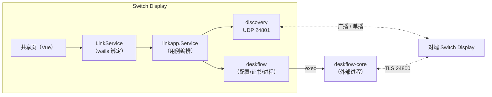
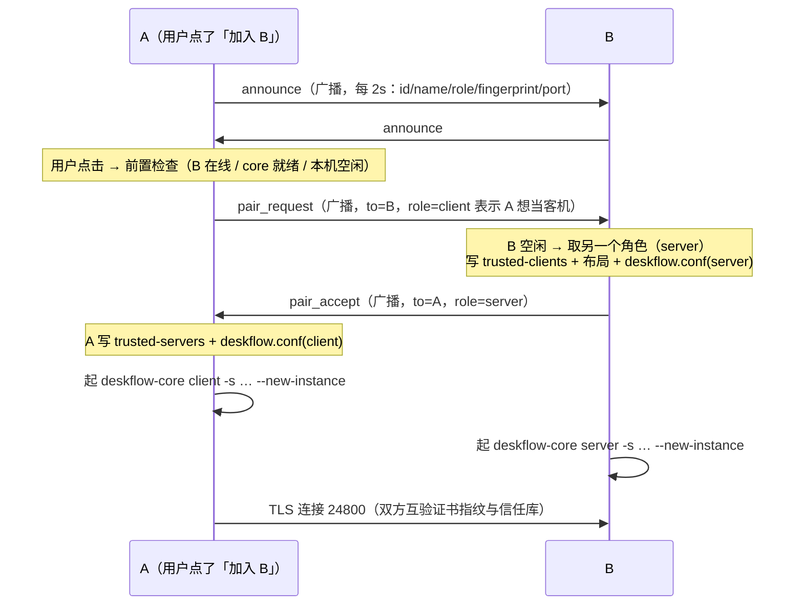

# Deskflow 集成：局域网共享鼠标键盘（自发现 + 配对 + 选主机）

> 状态：**代码完成，待两台真机联调**（进度与剩余项见 §9「执行进度」）
> 关联文档：[plan.md](plan.md)（DDC/CI 主需求）、[architecture.md](architecture.md)（架构唯一事实来源）
> 本文只描述**新增的 link 子系统**；与 DDC/CI 的交叉点只有「配置目录」与「Wails 服务注册」两处。

---

## 1. 目标与验收

用户原话（m00002）：

> 在当代码里再添加 github 上的 deskflow 来做到共享鼠标键盘。能在同一局域网中打开两个软件后**自发现配对**，然后**用户选择用哪个作为共享鼠标键盘的主机**，这个功能。

拆成可验收的行为：

| # | 场景 | 期望 |
|---|---|---|
| A1 | 两台机器都装了 Deskflow、都打开 Switch Display，在同一局域网 | 数秒内双方列表里出现对方（名称 + IP + 角色），**无需手动输入 IP** |
| A2 | 我在 A 上点「用这台作为主机」（选 B） | A 变 client、B 自动变 server；两端 TLS 指纹自动互相写入信任库，**不弹任何 Deskflow 原生弹窗** |
| A3 | A2 之后把鼠标移到 A 的屏幕边缘 | 鼠标键盘跨到 B（Deskflow 原生行为） |
| A4 | 任一端点「停止共享」 | 两端 core 进程退出、发现列表回落到「空闲」 |
| A5 | 未安装 Deskflow | 页面明确提示「未找到 deskflow-core」+ 安装引导，不崩、不静默 |
| A6 | 退出应用 / 崩溃 | core 子进程被回收（不留孤儿监听 24800） |

**非目标**：不做多显示器网格布局编辑（默认横排「左-右」双向链接）；不做剪贴板之外的 Deskflow 高级项；不做跨子网发现（只做同网段广播）。

---

## 2. 关键结论（已完成的调研，附证据）

### 2.1 Deskflow 自身**没有**任何局域网发现

在 `deskflow` v1.27.0 全量源码里 grep `mdns|zeroconf|bonjour|avahi|discover|broadcast`，只命中无关项（`CondVar::broadcast`、`WM_POWERBROADCAST`、`KeyboardBroadcastAction`）。

→ **自发现与配对必须由 Switch Display 自己实现**；Deskflow 只被当作「由配置文件驱动的 server/client 进程」。

### 2.2 core 的 CLI 只有一个位置参数

`src/apps/deskflow-core/CoreArgParser.cpp`：

```
deskflow-core <server|client> [-s <settingsFile>] [--new-instance]
```

- 无参数/非法模式 → 打印 help 后 `exit(s_exitSuccess)`（**是 0 不是错误码**，所以不能只靠退出码判断「参数错了」）。
- 单实例用 `QSharedMemory(kCoreBinName)`：`!create(1) && singleInstanceOnly()` → `LOG_WARN("an instance of deskflow core is already running")` + `s_exitDuplicate=5`；`--new-instance` 可绕过。
- 退出码（`src/lib/common/ExitCodes.h`）：`0` 成功、`1` failed、`2` terminated、`3` args、`4` config、`5` duplicate。

### 2.3 配置是 QSettings INI，可用 `-s` 完全外置

`-s` 实际只做 `Settings::setSettingsFile(path)`，**不改 state 文件位置**（state 只存窗口几何等，对 headless core 无影响）。

我们关心的键（`docs/Configuration.md`）：

```ini
[core]
coreMode=2                 ; 0 None / 1 Client / 2 Server
port=24800                 ; 默认 24800
computerName=my-mac        ; 必须与 server 布局文件里的主机名一致
interface=                 ; 留空 = 绑 0.0.0.0

[client]
remoteHost=192.168.1.20    ; 支持逗号分隔多地址

[server]
externalConfig=true
externalConfigFile=<path>/deskflow-server.conf

[security]
tlsEnabled=true
checkPeerFingerprints=true
certificate=<path>/tls/deskflow.pem
keySize=2048
```

### 2.4 「自动配对」= 程序化预置指纹信任库（决定性发现）

`SecureSocket::verifyCertFingerprint()`（`src/lib/net/SecureSocket.cpp:616`）：

1. `SSL_get_peer_certificate` → `sslCertFingerprint(cert, Sha256)`；
2. 读信任库（server 校验 `<tls>/trusted-clients`，client 校验 `<tls>/trusted-servers`）；
3. **文件存在但解析出 0 条** → `LOG_ERR("failed to open trusted fingerprints file: %s")` → 拒绝；
4. `db.isTrusted(sha256)` 命中 → 通过。

落盘格式（`Fingerprint::toDbLine()`）= **`v2:sha256:<64 位小写 hex>`**（注意：与 GUI 展示用的大写带冒号形式不是一回事）。空行跳过、非法行静默丢弃。

→ 只要双方各自把自己的证书指纹通过发现通道交换，并写进对端的信任库文件，就能**零点击完成 TLS 配对**，且比 `checkPeerFingerprints=false` 更安全（仍是指纹绑定）。

### 2.5 core **不会自己生成证书**

`SecureSocket::loadCertificate()`：文件不存在 → `LOG_ERR("tls certificate doesn't exist: ...")` → 失败。

证书由 GUI 的 `TlsUtility::generateCertificate()` 调用 `generatePemSelfSignedCert(path, 2048)` 生成（`src/lib/net/SecureUtils.cpp:66`）：RSA、serial=1、365 天、CN=`Deskflow`、`X509_sign(..., EVP_sha256())`、**证书与私钥写在同一个 PEM 文件**。

→ Switch Display 用 Go `crypto/rsa` + `crypto/x509` 生成等价文件即可，无需用户先跑一次 Deskflow GUI。

### 2.6 Server 布局文件是 Deskflow 自有语法（第二个文件）

`src/lib/server/Config.cpp:637 readSectionLinks`：`section: links` 下，以 `:` 结尾的行是**规范主机名**（不能用 alias），其余行是 `side = 目标主机`，`side ∈ left/right/up/down`，可带 `(start,end)` 百分比区间；区间重叠报 `overlapping range`；**必须双向声明**，否则鼠标移过去回不来。

```conf
section: links
	alpha:
		right = beta
	beta:
		left = alpha
end
```

### 2.7 状态：端口探测定就绪，日志只做辅助

- Server 侧**没有** `started server` 的 INFO 行（`started server, waiting for clients` 是 **DEBUG**），只有 `stopped server`、`reloaded configuration` 是 INFO；
- Client 侧 `INFO: started client`、`INFO: connected to secure socket`、`WARN: failed to connect to server: %s`；`connected to server` 是 **DEBUG**；
- 我们生成的配置写 `[log] level=info`，所以 DEBUG 行根本不会输出 → **不能用 `connected to server` 判断连上**，必须用 INFO 级别的 `connected to secure socket`（Client）/ `accepted client connection`（Server）；
- 就绪的权威信号是 **server 端口能连通**（`127.0.0.1:24800`），日志只用于给用户显示「在做什么」；
- client 连接失败会自动 `scheduleClientRestart()` 循环重试 → **进程常驻即可，无需外部重启**。
- 日志格式 `src/lib/base/Log.cpp:91`：`[<ISO8601>] <LEVEL>: <msg>`，`ConsoleLogOutputter` 把 Info/Debug 写 `stdout`、Fatal..Warning 写 `stderr` → **我们可以直接捕获子进程 stdout/stderr 做状态展示**，不必配置 `[log] file`。
- **降噪**：我们的 TCP 就绪探测会被 Deskflow 当成一次失败的 TLS 握手，打印 `ERROR: failed to accept secure socket`（`src/lib/net/SecureSocket.cpp:425`）。这行必须显式忽略，否则 server 刚起来就被判成失败。
- **WARN 不能判死**：client 连不上 server 时反复打 `WARN: failed to connect to server: Connection refused` 并自己重试；把它当成失败会让「先开 client、后开 server」这个常见顺序永远起不来。只有 `ERROR/CRIT/FATAL` 在 `starting` 阶段才判失败，且一旦出现 `connected to secure socket` / `accepted client connection` 就无条件翻回 `running`（覆盖「首连失败、重试成功」）。

---

## 3. 总体设计

### 3.1 职责切分



这张图回答：**谁负责发现、谁负责配对、谁负责跑进程**——发现与配对全在我们这边，Deskflow 只被 `exec` 驱动。

### 3.2 配对握手（零点击，语义上仍是用户主动选择）



这张图回答：**为什么不需要 PIN**——A 侧用户点击即视为对 B 的授权，B 侧收到邀请即视为对 A 的授权；双方指纹通过同一通道交换，各自写入对端信任库（`trusted-servers` / `trusted-clients`），因此 TLS 握手时无需人工确认。

信令报文（`link.Message`，JSON，UDP 24801）：

| type | 传输 | 字段 | 说明 |
|---|---|---|---|
| `announce` | 广播 | `v,type,id,name,role,fp,port` | 每 2 秒一次；对端表 TTL 7 秒 |
| `pair_request` | 广播 + `to` | `v,type,id,name,role,fp,port,to` | `role` = **发起方想担任的角色**，接收方取另一个 |
| `pair_accept` | 广播 + `to` | 同上 | 回带的 `role` 是接收方担任的角色 |
| `pair_reject` | 广播 + `to` | `v,type,id,to,reason` | 本机已有共享 / 指纹非法 |
| `bye` | 广播 | `v,type,id` | 停止共享；对端若为客机则一并停 core |

`role ∈ idle|server|client`。`id` 是持久化的随机设备 ID（不是 hostname——hostname 会撞名）。

> **为什么信令走广播而不是单播**：单播依赖「看到的对端地址一定能直达它」，而
> 多网卡 / VPN / 同机双实例（`SO_REUSEPORT` 会把单播投给其中一个 socket）时常不成立。
> 广播在同一广播域内一定到达，代价是每条报文都要用 `to` 字段过一遍收件人。

### 3.3 为什么用独立配置文件而不是塞进 config.json

`config.json` 的 `Snapshot.Version` 是单调迁移的（ADR-004）；把运维态（设备 ID、最近一次配对）混进去会迫使版本号升级并要求写迁移分支。link 的状态**可以丢**（丢了只是重新配对一次），因此单独 `link.json`，独立版本号，坏了自己重置，不影响 DDC 配置。

`~/.config/switch-display/link.json`（macOS: `~/Library/Application Support/switch-display/link.json`）：

```json
{
  "version": 1,
  "deviceId": "3f2a…",
  "deviceName": "nnn-macbook",
  "lastHostId": "9c81…",
  "trusted": []
}
```

Deskflow 侧文件全部放在 `~/.config/switch-display/deskflow/` 下（**不用** `~/Library/Deskflow`，避免污染用户自己的 Deskflow GUI 配置）：

```
deskflow/
├── deskflow.conf              # 每次切换角色时重写
├── deskflow-server.conf       # server 布局（仅 server 模式）
└── tls/
    ├── deskflow.pem           # 证书+私钥同文件（首次生成）
    ├── trusted-clients        # server 侧：信任的 client 指纹
    └── trusted-servers        # client 侧：信任的 server 指纹
```

---

## 4. 目录与模块落点（按 architecture.md 分层）

按 R1–R8 落位；新增包全部遵守「接口定义在使用方」。

```
internal/
├── domain/link/                     # 纯 Go，只 import 标准库
│   ├── peer.go                      # Peer 聚合 + Role + 设备 ID 生成/校验
│   ├── message.go                   # Wire 报文（announce/pair_*/bye）+ 编解码
│   ├── settings.go                  # LinkSettings + Validate + 默认值
│   ├── repository.go                # Repository 端口 + Snapshot
│   └── errors.go                    # ErrPeerNotFound / ErrNoCore / ErrBusy …
├── application/linkapp/
│   ├── service.go                   # Status / Peers / PairWith / Stop / 自动过期
│   └── service_test.go
├── infrastructure/link/
│   ├── discovery/                   # 实现 link.Transport（UDP 广播+单播）
│   │   ├── udp.go                   # SO_REUSEADDR|SO_REUSEPORT、广播、收包循环
│   │   ├── peers.go                 # 对端表 + TTL 过期
│   │   └── udp_test.go
│   └── deskflow/                    # 实现 link.CoreRuntime
│       ├── locate.go                # 找 deskflow-core 可执行文件
│       ├── cert.go                  # 自签 PEM + SHA-256 指纹
│       ├── config.go                # 写 deskflow.conf / deskflow-server.conf / 信任库
│       ├── process.go               # exec + stdout/stderr 采集 + 退出回收
│       ├── * _test.go
└── presentation/wailsservice/
    └── linkservice.go               # LinkService（第二个 Wails 服务）
```

前端：`frontend/src/views/ShareView.vue` + `stores/link.ts` + 路由 `/share` + 侧栏项 + i18n 两套文案。

---

## 5. 领域模型

```go
// domain/link
type Role string // "idle" | "server" | "client"

type Peer struct {
    ID          string // 持久化随机 ID（32 hex）
    Name        string // 人类可读设备名
    Address     netip.AddrPort
    Fingerprint string // v2:sha256:<64 lowercase hex>
    Role        Role
    LastSeen    time.Time
}

func (p Peer) Stale(now time.Time, ttl time.Duration) bool
```

不变量：
1. `ID` 必须 32 位小写 hex；`Name` 非空且 ≤ 64 字符（去控制字符）；
2. `Fingerprint` 必须匹配 `^v2:sha256:[0-9a-f]{64}$`（空串表示对端尚未生成证书，允许出现但不可配对）；
3. 自己不能出现在 Peer 表里（按 `ID` 过滤）。

---

## 6. 安全与失败模式

| 风险 | 处置 |
|---|---|
| 广播被同网段任意程序伪造 | 配对只接受「用户点击触发的单播邀请」+ 指纹与 `announce` 一致；不接受匿名 `pair_request` 直接启动 server（必须 `Fingerprint` 合法且与对端 announce 匹配） |
| 明文传输 | 默认 `tlsEnabled=true` + `checkPeerFingerprints=true` + 预置信任库（ADR-010） |
| 端口 24800 被用户自己的 Deskflow GUI 占用 | 传 `--new-instance` 启动；若 server 绑定失败，从子进程 stderr 里抓 `cannot open` / `bind` 关键词并上报「端口被占用」 |
| 孤儿进程 | `exec.Command` + 显式 `Process.Kill()`，并在 `ServiceShutdown` / 进程退出 / `Stop` 三处回收 |
| 未装 Deskflow | `locate` 失败 → `ErrNoCore`，UI 给安装引导，不影响 DDC 功能 |
| 证书过期（365 天） | 启动时校验 `NotAfter`，过期则重新生成并让双方重新配对（`trusted` 表清空） |

---

## 7. 实施步骤

| # | 步骤 | 产物 | 验收 |
|---|---|---|---|
| S1 | 本文件（进度 + plan） | `docs/deskflow-integration.md` | 文档可读、步骤可执行 |
| S2 | `domain/link` | peer/message/settings/repository/errors + 单测 | `go test ./internal/domain/link` |
| S3 | `infrastructure/link/discovery` | UDP 广播 + 对端表 + 单测 | 两台机器/两个进程互相看到 |
| S4 | `infrastructure/link/deskflow` | locate/cert/config/process + 单测 | 生成 PEM 与信任库格式正确 |
| S5 | `infrastructure/persistence` | `linkstore.go`（`link.json` 原子写） | 与 jsonstore 同风格单测 |
| S6 | `application/linkapp` | Service 编排 + fake 端口单测 | 配对/停止/过期用例通过 |
| S7 | `presentation/wailsservice` + `bootstrap` + `main.go` | `LinkService` 注册、事件名、生命周期 | `wails3 generate bindings` 通过 |
| S8 | 前端 | `/share` 页 + store + i18n + 侧栏 | `pnpm build` 通过、页面能显示设备 |
| S9 | 文档同步 | architecture.md §3/§4/§5/§10/§13、plan.md、README.md | 清单自查 |
| S10 | 验证 | `gofmt` / `go vet` / `go test` / 前端 build / 真机两端联调 | 见 §8 |

---

## 8. 验证清单

```bash
gofmt -l internal/ main.go
go vet ./internal/... .
go test ./internal/... -cover
# 联调一（真 UDP 广播 + 假 core 子进程，端口 24981）
go test -tags link_integration ./internal/application/linkapp/ -run TestPairingEndToEnd -v
# 联调二（真 deskflow-core，端口 24983，见下）
DESKFLOW_CORE=/Applications/Deskflow.app/Contents/MacOS/deskflow-core \
  go test -tags deskflow_real ./internal/application/linkapp/ -run TestRealCorePair -v
cd frontend && ./node_modules/.bin/vue-tsc --noEmit && npm run build
```

`TestPairingEndToEnd` 用两个真实 `linkapp.Service`（真 UDP 发现 + 真 `deskflow.Engine`，
core 用一个 `#!/bin/sh` 假脚本代替真 Deskflow）在同一台机器上跑完整握手，
断言：互相发现 → `JoinHost` → 双方角色互换 → `trusted-servers`/`trusted-clients`
各自落盘 → 停止后角色回 idle。它不验证真实键鼠传递（那需要两台真机 + 真 Deskflow）。

`TestRealCorePair`（`//go:build deskflow_real`）用真 `deskflow-core` 跑同一套握手，验证
「预置指纹信任库 → 零点击配对」在真进程上成立：A 成为 client、B 成为 server，双方
`core=running`，`tls/trusted-servers` 与 `tls/trusted-clients` 各落盘。本机实测
3.3 秒通过。**前置条件：显示器必须唤醒**——Deskflow 的 `OSXComputer` 用
`CGGetActiveDisplayList` 判断显示器数量，休眠时返回 0 就直接抛
`DisplayInvalidException` 退出（`src/lib/platform/OSXComputer.mm:119`），跟本集成无关。

真机联调（需要两台机器 + 都装 Deskflow）：

1. 两端启动 → 共享页互相出现；
2. A 上选 B 为主机 → 两端状态变 `server/client`，`~/…/switch-display/deskflow/tls/trusted-*` 各有 1 行；
3. 鼠标穿屏成功；
4. A 点停止 → 两端回 `idle`，24800 端口释放；
5. 杀掉 A 的进程 → B 侧 Peer 10s 内消失，B 的 core 保持运行但显示「等待连接」。

---

## 9. 执行进度

| 步骤 | 状态 | 说明 |
|---|---|---|
| 调研（Deskflow 能力面） | ✅ 完成 | v1.27.0 全量源码核对：CLI、配置键、TLS 指纹库、布局语法、退出码、日志输出 |
| S1 文档 | ✅ 完成 | 本文件 |
| S2 domain/link | ✅ 完成 | `link.go` / `errors.go` / `message.go` / `settings.go` / `runtime.go` + 单测，覆盖率 80.3% |
| S3 discovery | ✅ 完成 | `udp.go` + `socket_{posix,windows}.go` + `reuseport_{darwin,linux,other}.go` + `broadcast.go`，覆盖率 46.4%（收发主循环需要真网卡，靠下面的联调补） |
| S4 deskflow runtime | ✅ 完成 | `cert.go` / `config.go` / `locate.go` / `process.go` / `engine.go` / `terminate_{posix,windows}.go`，包覆盖率 66.7% |
| S5 linkstore | ✅ 完成 | `linkpaths.go` / `linkstore.go`，覆盖率 73.8% |
| S6 linkapp | ✅ 完成 | `ports.go` / `service.go` + fake 端口单测，覆盖率 79.1% |
| S7 service/bootstrap/main | ✅ 完成 | `LinkService` 已注册；`wails3 generate bindings` 生成 2 services / 17 methods / 14 models |
| S8 前端 | ✅ 完成 | `/share` 页 + `stores/link.ts` + `api.linkApi` + 侧栏入口 + 中英文案；`vue-tsc` 与 `npm run build` 通过 |
| S9 文档同步 | ✅ 完成 | architecture.md §3/§4/§5/§7/§10/§13、README.md 索引 |
| S10 验证 | 🟡 大部分完成 | 静态检查、单测、`vue-tsc`、`npm run build` 全绿；**同机双实例联调通过**（`-tags link_integration`）；**真 `deskflow-core` v1.27.0 配对通过**（`-tags deskflow_real`，3.3s）；**两台真机跨机器联调待做**（需要第二台设备，见 §9.2） |

### 9.1 实现与本文档设计的偏差（已按实现更新）

1. **`link.json` 与 `deskflow/` 同目录**：都在 `os.UserConfigDir()/switch-display/` 下，`link.json` 与 `config.json` 平级。
2. **Deskflow 主机名由设备 ID 派生**：`link.ComputerNameFor(id)` → `sd-<id 前 10 位>`。原因：布局文件和 client 的 `computerName` 必须一致，而两端唯一天然共享的标识就是设备 ID；用户可见名（`DeviceName`）只用于 UI。
3. **`WriteServerLayout` 允许空 links 段**：只有本机一台时 Deskflow 仍需 `section: links` + `end` 才能通过解析。
4. **信任库为空时删文件而不是写空文件**：Deskflow 对「文件存在但 0 条指纹」直接 `LOG_ERR` 拒绝连接。
5. **证书重新生成会清空 `trusted`**：旧指纹全部失效，留着只会让对端连接被拒。
6. **`Bye` 的处理**：对端停止时，若本机是 client 则一并停掉 core，避免对着已消失的主机无限重连；server 侧不动（它还可能在等其它客机）。
7. **提示与状态说明都用稳定标识而不是中文**：`PairResultDTO.Message` 返回 `pair_invite_sent` / `pair_join_sent` / `name_updated` / `sharing_stopped` / `peer_unpaired`，`CoreStatusDTO.Message` 返回 `client_started` / `client_stopped` / `exit_args` / `exit_config` / `exit_duplicate`，配对拒绝的原因码是 `fingerprint_invalid` / `busy` / `unknown`；前端 `share.notice.*` / `share.coreMsg.*` / `share.reject.*` 负责翻译（与 `switchapp.messageFor` 同一约定，后端不掺语言）。**例外**：Deskflow 自己输出的 ERROR/CRIT 行是英文原文，翻不出来，前端原样透传。
8. **`reuseport` 按平台拆三个文件**：Linux 的 `SO_REUSEPORT` 不在 `syscall` 包里（`undefined: syscall.SO_REUSEPORT`），必须走 `golang.org/x/sys/unix`；其它平台退化为 no-op。原先一个 `reuseport_posix.go` 只能编过 macOS。

### 9.2 尚未验证的部分（S10 剩余）

- **两台真机跨机器联调**：同一台 Mac 上的双实例已跑通（发现、握手、角色互换、真 core 的 TLS 互认），但「A 的鼠标真的能移到 B 的屏幕」需要第二台设备，只能在你的两台机器上验。
- **多网卡广播**：`directedBroadcasts()` 实测能算出 `192.168.1.255:24801`，同机双实例也能互收；但跨机器的定向广播是否被交换机/AP 放行（尤其是企业网与访客网）只能实测。
- **Windows**：`discovery/socket_windows.go` 与 `deskflow/terminate_windows.go` 只做了交叉编译验证（`GOOS=windows go build ./internal/infrastructure/link/...`），未在 Windows 上运行。Windows 侧 Deskflow 需要额外注意 UAC/服务权限（键鼠注入要管理员）。
- **macOS 辅助功能权限**：Deskflow 注入键鼠事件需要「辅助功能」授权，首次运行时系统会弹窗，用户必须手动允许（我们无法代劳）。

### 9.3 真 core 联调中的环境坑（实测记录）

| 现象 | 原因 | 处理 |
|---|---|---|
| `FATAL: a display invalid exception error occurred: failed to initialize computer shape` 立即退出 | 显示器休眠时 `CGGetActiveDisplayList` 返回 0（`OSXComputer.mm:1313`） | 先 `caffeinate -u` 唤醒显示器；真实用户在用电脑时不会遇到 |
| `Library not loaded: @rpath/QtWidgets.framework/...` | `deskflow-core` 依赖 bundle 内的 `Contents/Frameworks` | 必须整包使用 `Deskflow.app`，不能单独拷二进制 |
| `ERROR: failed to accept secure socket` | 我们的 TCP 就绪探测触发的失败握手 | 已在 `logEventFor()` 里列为 benign，忽略 |
| `hdiutil attach` 卡住 / `attach canceled` | dmg 带 license 提示 | `yes \| hdiutil attach -nobrowse <dmg>` |

## 10. 待确认（不阻塞实施，先按推荐值做）

1. **发现端口**：用 `24801/UDP`（Deskflow 用 `24800/TCP`，错开）。若与其它软件冲突，改一处常量即可。
2. **设备名默认值**：`os.Hostname()`，用户可在共享页改。
3. **是否允许「本机作为主机、被动等待」**：允许——主机也可以主动进入 server 模式，等对端点「连接到主机」。
4. **布局方向**：默认 `A right of B` 的双向链接（鼠标从 A 右缘过去）。多屏/上下布局留待后续（布局文件已支持，只是 UI 没做）。
