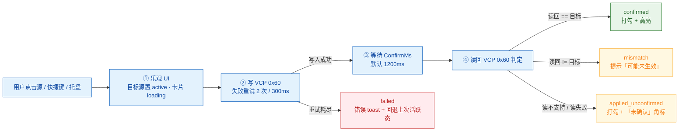

# Switch Display — 实施方案（Plan）

> 状态：**待评审**。这份文档是给用户确认需求用的，确认后再开始写代码。
> 项目：`/Users/nnn/Documents/code/gowails/switch_display`（Wails v3 beta.34 + Vue 3 + TS，当前是模板工程）

---

## 1. 目标

一台外接显示器同时接了多个系统（Mac mini / Windows 主机 / 游戏机 / 另一台笔记本），
显示器通过 DDC/CI 的 **VCP 0x60（Input Source）** 切换输入口。
做一个 macOS 菜单栏常驻的小工具：

- 列出**已配置的信号源**（比如「Mac」「工作 PC」「PS5」），点一下就把显示器切到它对应的输入口；
- 支持**菜单栏快速切换** + **每源一个全局快捷键**；
- 尽量**读回当前输入源并高亮**（best-effort，很多显示器不支持读，见 §7）。

同一套软件还负责**局域网共享鼠标键盘**（第二个需求，见 §12 第 12 步与
[deskflow-integration.md](deskflow-integration.md)）：两台机器都打开本软件后互相发现，
由用户选一台作为主机，两台共用一套鼠标键盘。键鼠传递由 Deskflow 内核进程完成，
本软件只负责「发现 + 配对 + 拉起与配置 core」。

不做的事：不做通用显示器控制面板（亮度/对比度/音量）—— 后续可作为附加页。
不做多显示器矩阵（数据模型预留，见 §4）。
不做跨子网/跨网段发现（只覆盖同一广播域，见 deskflow-integration.md §1）。

---

## 2. 现状与已完成的可行性验证

在本机（Apple M6，macOS 27.0.1，CLT 已装，`Mi Monitor`）上已实测：

| 项 | 结果 |
|---|---|
| `m1ddc` 从源码 `make` | ✅ 编译通过 |
| `m1ddc display list detailed` | ✅ 能枚举显示器：System UUID `7E4E3972-…`、EDID `61A9B127-…`、Vendor `0x61a9`、Model `0x27b1`、Adapter、IO Location |
| `m1ddc set contrast 50` | ✅ DDC 写成功 |
| **Go + cgo 直接调 `IOAVServiceWriteI2C`** | ✅ 返回 0（不需要依赖外部 m1ddc 二进制） |
| Go + cgo 读 VCP 0x10/0x12 | ✅ `0x10` 亮度 cur=100/max=100，`0x12` 对比度 cur=50/max=100 |
| Go + cgo 读 VCP 0x60（输入源） | ⚠️ 返回 `cur=18 max=14`，**当前高亮值不可靠**（该显示器/该链路不支持读 input，或返回被截断）。所以 UI 必须能优雅降级。 |
| cgo 编译 `.m` Objective-C 文件 | ✅ 已验证 `#cgo CFLAGS: -fmodules` + `.m` 与 Go 同包编译可行 |

**→ 结论：内置 cgo 实现，用户不需要额外安装任何东西。** 这是你选的方案。

### Windows 侧实测（同一份代码的 Windows 端口）

在本机（Windows 11，NVIDIA RTX 4060，接 `Mi Monitor` + `P25A2G` 两台显示器）上实测：

| 项 | 结果 |
|---|---|
| `EnumDisplayMonitors` + `GetMonitorInfoW` | ✅ 枚举出 `\\.\DISPLAY1` / `\\.\DISPLAY2` |
| `EnumDisplayDevicesW` + `EDD_GET_DEVICE_INTERFACE_NAME` | ✅ 拿到设备接口路径 `\\?\DISPLAY#XMI27B1#5&187333d6&0&UID20738#{e6f07b5f-...}` |
| 注册表 `Enum\<实例>\Device Parameters\EDID` | ✅ 两台都读到（384 / 256 字节）；`Default_Monitor` 这类伪实例没有 EDID，需容错 |
| `GetPhysicalMonitorsFromHMONITOR` | ✅ 句柄是 0 和 1 —— **0 是合法值**，不能当失败判据 |
| `GetVCPFeatureAndVCPFeatureReply` | ✅ 亮度 `0x10` 读到 100/100、90/100；输入源 `0x60` 读到 16/7（与 macOS 一致，`cur > max` 同样不可信） |
| `SetVCPFeature` | ✅ 写成功（`WriteVCP` 走它） |
| Alt 通道（`0xF4` @ I2C `0x50`） | ❌ Dxva2 无切从地址能力 → 返回 `ErrUnsupported`（ADR-009） |

**→ 结论：Windows 用纯 `syscall`（`x/sys/windows` 的 `NewLazySystemDLL`）实现，零 cgo，不需要 MSVC。**

技术来源：移植 [waydabber/m1ddc](https://github.com/waydabber/m1ddc)（MIT）的 `i2c.m` + `ioregistry.m` 逻辑到 Go 的 cgo 层。

---

## 3. 架构

**代码风格：DDD + 整洁架构（Clean / Hexagonal），四层 + 装配根。**
详细分层规则、目录树、接口契约、ADR 与维护约定见 **[architecture.md](architecture.md)**（活文档，改需求/改代码必须同步）。

一句话概括依赖方向：`presentation → application → domain`，`infrastructure → domain`（实现端口），
`main.go` 是唯一装配根；`domain` 零外部依赖、可无 cgo 单测。

| 目录 | 职责 |
|---|---|
| `main.go` | 装配根：建依赖 → 注册服务/托盘 → `app.Run()` |
| `internal/bootstrap/` | 依赖构造与生命周期（含显示器热插拔监听） |
| `internal/domain/display/` | Display 聚合、VCP 值对象、`Port` 接口（枚举/读/写） |
| `internal/domain/source/` | SignalSource 聚合 + 不变量、端口预设、Accelerator、`Repository` 接口 |
| `internal/domain/switching/` | 领域服务：重试 / 确认窗口 / 四态结果判定 |
| `internal/application/` | 用例编排：`switchapp` / `configapp` / `displayapp` / `dto` |
| `internal/infrastructure/ddc/` | DDC/CI 适配：`darwin`（cgo，唯一 `import "C"` 处）、`windows`（纯 syscall + Dxva2）、`linux`（桩） |
| `internal/infrastructure/persistence/` | JSON 原子写 + `.bak` + 迁移 + 跨平台路径 |
| `internal/infrastructure/platform/` | `hotkey` / `events` / `paths`（原生对话框、打开目录） |
| `internal/presentation/` | `wailsservice`（薄适配）+ `tray`（菜单） |

> 完整目录树（含每个文件名与职责）见 [architecture.md §3](architecture.md)——**那里是唯一事实来源**，
> 本文只列层级职责，避免两处目录树各自漂移。

### 分层原则

- `domain/display.Port`（由平台实现）：
  ```go
  type Port interface {
      List(ctx context.Context) ([]Display, error)
      ReadVCP(ctx context.Context, id DisplayID, vcp VCPCode, alt bool) (ReadBack, error)
      WriteVCP(ctx context.Context, id DisplayID, v InputValue) error
  }
  ```
- 「一个 Source = 显示器 + 输入口」的规则在 `domain/switching`；步骤编排在 `application/switchapp`；只有 `presentation` 会发 Wails 事件/建菜单。
- 前端只跟 Wails service 打交道，不直接碰 cgo；`src/api/` 包一层 bindings。

---

## 4. 数据模型

```go
// 持久化快照（= domain/source.Snapshot 的 JSON 映射）
type Snapshot struct {
    Version  int        `json:"version"`   // 目前 1，迁移用
    Settings Settings   `json:"settings"`
    Sources  []Source   `json:"sources"`
}

// 注意：Display 不进配置文件——它是从硬件实时枚举的只读快照，
// Source 只存 DisplayID 引用（换显示器后不会因 ID 变化而丢失，UI 提示重新绑定）。
type Settings struct {
    ConfirmAfterSwitch bool `json:"confirmAfterSwitch"` // 切换后等读回（默认 true）
    ConfirmMs          int  `json:"confirmMs"`          // 默认 1200
    Retries            int  `json:"retries"`            // 默认 2
    Language           string `json:"language"`         // "zh" / "en"
    DebugMode          bool `json:"debugMode"`
}

type Display struct {
    ID       string `json:"id"`        // macOS: System UUID（稳定）；Windows: monitor device id；Linux: connector+edid
    Name     string `json:"name"`      // 用户可改名
    Vendor   uint32 `json:"vendor"`
    Model    uint32 `json:"model"`
    Serial   uint32 `json:"serial"`
    EDID     string `json:"edid"`
}

type Source struct {
    ID         string   `json:"id"`          // 本地 uuid（crypto/rand）
    Name       string   `json:"name"`        // "Mac" / "工作 PC" / "PS5"
    Color      string   `json:"color"`       // 用于 UI 圆点/图标色，"#7E4E39" 之类
    Icon       string   `json:"icon"`        // 内置 icon 名（见 §6.3）
    DisplayID  string   `json:"displayId"`   // 对应 Displays[].ID
    VCP        uint8    `json:"vcp"`         // 默认 0x60；LG 备用 0xF4
    Value      uint16   `json:"value"`       // 15/16/17/18/27… 或自定义
    Alt        bool     `json:"alt"`         // LG alternate（chip address 0x50）
    Shortcut   string   `json:"shortcut"`    // "Cmd+Option+1"，空=不绑
    ConfirmMs  int      `json:"confirmMs"`   // 切换后等待读回高亮的时长，默认 1200
}
```

### 存储位置（跨平台，用 `os.UserConfigDir()`）

| 系统 | 路径 |
|---|---|
| macOS | `~/Library/Application Support/switch-display/config.json` |
| Windows | `%AppData%\switch-display\config.json` |
| Linux | `$XDG_CONFIG_HOME/switch-display/config.json`，否则 `~/.config/switch-display/config.json` |

- 写入用「临时文件 + rename」原子替换；
- 保留 `config.json.bak`（上一版）；
- 提供**导入/导出**按钮（导出用原生保存对话框，导出为 `switch-display-config-YYYYMMDD.json`）。

---

## 5. 后端服务（暴露给前端）

Wails v3 service，命名 `DisplayService`（**薄适配层**：只做 DTO 映射 + 错误转文案，
实际逻辑在 `internal/application/*app`，规则在 `internal/domain`）：

```go
// 显示器
func (s *DisplayService) ListDisplays() ([]DisplayInfo, error)         // 实时枚举 + 是否已在配置里
// 配置
func (s *DisplayService) GetConfig() (Config, error)
func (s *DisplayService) SaveConfig(cfg Config) error                 // 保存后重建托盘 + 重绑快捷键
func (s *DisplayService) ExportConfig() (string, error)               // 返回 JSON 字符串
func (s *DisplayService) ImportConfig(json string) (Config, error)
// 切换
func (s *DisplayService) SwitchSource(sourceID string) (SwitchResult, error)
func (s *DisplayService) ReadCurrentInput(displayID string) (ReadResult, error)  // {supported bool, vcp, value}
// 诊断
func (s *DisplayService) ProbeVCP(displayID string, vcp uint8, alt bool) (ReadResult, error)  // 高级页：读一次探测是否支持
```

**事件**（前端 `Events.On` 订阅）

| 事件 | payload | 时机 |
|---|---|---|
| `switch:started` | `{sourceId}` | 点击切换 |
| `switch:result` | `{sourceId, outcome, confirmed, error, elapsedMs}` | 完成（含重试后） |
| `dialogs:open-settings` | — | 托盘点了「设置…」 |
| `state:refresh` | — | 显示器热插拔（1s 防抖）后，前端刷新列表 |

`SwitchResult` 里带 `error` 字符串，前端 toast。`Outcome` 用四态
（`confirmed` / `mismatch` / `applied_unconfirmed` / `failed`），理由见 §8 与 architecture.md ADR-003。

映射关系：`ListDisplays/ReadCurrentInput/ProbeVCP` → `application/displayapp`；
`GetConfig/SaveConfig/Export/Import` → `application/configapp`；`SwitchSource` → `application/switchapp`。

---

## 6. 前端

### 6.1 技术栈

- **Tailwind CSS v4**（`@tailwindcss/vite` 插件，`@import "tailwindcss"`）
- **shadcn-vue**（Vite 安装流程，`components.json`，`@/` alias）
  - 用到的组件：`button`、`card`、`dialog`、`alert-dialog`、`input`、`label`、`select`、`switch`、`badge`、`tooltip`、`dropdown-menu`、`sonner`(toast)、`separator`、`scroll-area`、`tabs`、`switch`、`radio-group`、`field`(可选)
  - 主题：shadcn 默认 **neutral**，`light`/`dark` 双主题，跟随系统 + 手动切换（`next-themes` 思路自己写 20 行，不引 Nuxt 依赖）
- **Pinia** 管理：`useConfigStore`、`useDisplayStore`、`useUiStore`
- **Vue Router**：`/`（切换台）、`/sources`（信号源编辑）、`/settings`（显示器/高级/关于）
  - 也可以不引 router，用 `tabs` + 状态机。**建议引 router**，配 `hash` history（WebView 里 file:// 更稳）。
- **lucide-vue-next** 图标

### 6.2 页面

**导航（全局）**：**左侧可折叠 sidebar**（展开 204px / 收起 60px，折叠态持久化到 `localStorage["switch-display:nav-collapsed"]`）。顶部 40px 拖拽区（红绿灯落在这里），中间三个入口「切换台 / 信号源 / 设置」，底部「收起侧栏」与语言切换。选中项 = 白底 + 描边 + 加粗。

**1) 切换台（Home）** —— 主界面，也是设计重点

- 顶部：显示器 chips（名字 + 「本机」徽标；读不到就显示「未知」）
- 右上操作区：「重新检测」「+ 添加」（点击后在列表**上方**展开新增表单）
- 主体：信号源卡片列表，每张卡片：
  - 左侧图标 + 名称 + 端口标签（如 `HDMI 1`）；副信息固定行高 → 卡片等高
  - 当前激活的卡片：绿色描边 + 图标底色 + 「当前」徽标（靠读回或最近一次点击的乐观状态）
  - 右侧：结果徽标（成功/未生效/失败）+ 固定宽 74px 的「切换」按钮
  - 双击卡片也能切；hover 才显示删除按钮

**2) 信号源编辑（/sources）**

- **编辑器在列表上方**（这是硬要求：表单在下方时用户得往下翻才能录入）
- 勾「添加」或双击某行 → 顶部出现「新增信号源 / 编辑信号源」卡片，新增行立刻进入编辑态
- 编辑器字段（两列网格，用 `Field` 统一 label/hint 节奏）：名称、显示器（Select）、输入端口（Select 来自 §6.3 预设；选「自定义」则数值输入可编辑）、全局快捷键（点输入框进入录制模式，Esc 取消/清除）、确认等待（毫秒）；底部左侧显示 `VCP 0x60 = <value>` 等宽小字，右侧「取消 / 保存」
- 下方是表格化列表：列宽固定（名称 `flex-1` / 输入口 `w-20` / 快捷键 `w-28` / 确认 `w-16` / 操作 `w-16`），表头与行用同一套 padding，保证**跨行视觉对齐**
- 草稿整体提交：顶部「保存」一次落盘，旁边「撤销改动」丢弃未保存修改

**3) 设置（/settings）**

- 统一用 `SettingRow`（左标题/说明 + 右控件）：语言、关闭窗口时隐藏到菜单栏、切换后读回确认、确认等待默认值、本机源（「切回本机」指向哪个源）
- 配置路径只读展示（等宽字体），导入 / 导出走系统文件对话框

### 6.3 输入源预设（VCP 0x60）

| 端口 | 值 |
|---|---|
| DisplayPort 1 | 15 |
| DisplayPort 2 | 16 |
| HDMI 1 | 17 |
| HDMI 2 | 18 |
| USB-C | 27 |
| DVI 1 | 3 |
| VGA | 1 |
| 自定义 | 手填 0–65535 |

LG alternate（VCP 0xF4，chip address 0x50）：DP1=208、DP2=209、HDMI1=144、HDMI2=145、USB-C/DP3=210。

### 6.4 视觉

- shadcn 默认中性灰 + Tailwind v4 CSS 变量（`--background` / `--foreground` / `--primary` …）
- 删除模板的霓虹风格资源：`frontend/public/bg-desktop.jpg`、`bg-mobile.jpg`、`style.css` 里 `--ink/--glass` 那套、`index.html` 的 `.bg` div 和 `/style.css` 引用
- 窗口：**880×620**（不 resize），`MacTitleBarHiddenInset` 保留，内容延伸到标题栏（左侧栏顶部留 40px 拖拽区）；`MacBackdropTranslucent` 保留半透明底
- 组件化保证对齐：`PageShell`（页面标题/说明/操作区）、`Field`（label + 控件 + hint）、`SettingRow`（设置项）、`Badge`（状态徽标 6 变体）、`SourceEditor`（新增/编辑共用）

---

## 7. 托盘 + 全局快捷键

### 托盘（`app.SystemTray.New()`）

- 图标：单色 template icon（SVG→PNG @1x/@2x，深色/浅色自动适配），做成品牌感一点的「显示器 + 箭头」
- 单击：打开/聚焦主窗口
- 菜单：**每次配置变化/切换后全量重建**（ADR-005），结构如下表

| # | 菜单项 | 类型 | 行为 |
|---|---|---|---|
| 1 | 切换台 | 普通项 | 显示并聚焦主窗口 |
| 2 | *(分隔线)* | Separator | — |
| 3 | ● Mac `⌘⌥1` | **Radio**（选中 = 当前输入源） | 切到该源 |
| 4 | ○ 工作 PC `⌘⌥2` | Radio | 切到该源 |
| 5 | ○ PS5 `⌘⌥3` | Radio | 切到该源 |
| 6 | *(分隔线)* | Separator | — |
| 7 | 切回本机 | 普通项（配置了才显示） | 切回 Mac 自己的口 |
| 8 | 设置… | 普通项 | 发 `dialogs:open-settings` |
| 9 | 重新检测显示器 | 普通项 | 重新枚举 + 重建菜单 |
| 10 | *(分隔线)* | Separator | — |
| 11 | 退出 | 普通项 | `app.Quit()` |

- 第 3–5 项用 `AddRadio` 表示当前输入源（**读回可用**时以读回为准，否则以最近一次点击的乐观态为准）
- 第 7 项「切回本机」的绑定存在 `settings.selfSourceId`（**存信号源 ID 而不是端口值**：用户改源端口时它会自动跟随，不会指向过期端口）；为空时整项不显示
- 关窗口 = 隐藏到后台（`MacOptions.ApplicationShouldTerminateAfterLastWindowClosed = false` + 窗口关闭拦截 `Hide()`）
- 菜单栏「退出」才真退
- **右键托盘图标**：Wails beta.34 在 Windows 上漏了资源管理器直接投递的 `WM_CONTEXTMENU`（左键正常、右键无反应），由 `tray/uipi_windows.go` 的 `WndProcInterceptor` 补上；同时用 `ChangeWindowMessageFilter(Ex)` 放行 `WM_USER+1`，否则 `requireAdministrator` 运行时会因 UIPI 收不到任务栏的回调消息
- **语言**：托盘文案不读 vue-i18n，`labelsFor` 按「设置里的语言 > `LC_ALL`/`LC_MESSAGES`/`LANG`（忽略 `C`/`POSIX`）> 系统 UI 语言」判断；Windows 的系统 UI 语言用 `GetUserDefaultUILanguage` 取（`lang_windows.go`），Unix 才靠环境变量

### 全局快捷键

- `app.GlobalShortcut.Register(accel, cb)`，accel 用 Wails 语法（`Cmd+Option+1`，`CmdOrCtrl+Shift+F1`…）
- 保存配置时：`UnregisterAll()` 后按新配置全部重绑
- 注册失败（被别的 app 占用）→ 返回错误，UI 上该条标红并 toast「快捷键被占用」
- **录制 UI**：`keydown` 捕获修饰键 + 主键，转成 Wails accel 字符串（注意把 `Option+数字` 在 macOS 上会变成特殊字符，必须用 `event.code` 判断，不能看 `event.key`）

---

## 8. 切换流程与可靠性（重点）

DDC 写 KVM/输入源之后，显示器的输入切走会导致 **macOS 侧这块面板「离线」**，此时你没法再用同一个通道切回来 —— 但显示器其实还在响应 I2C，因为 DDC 通道走的是 DCP，只要显示器在 DP/HDMI 任意口上开着就还能写。实际经验里，**切换后立刻再写一次会失败**，需要：



1. **乐观 UI**：点击后立即把目标设为 active，卡片进入 loading（不等硬件回应，因为 DDC 写可能几百 ms）；
2. 写 VCP；失败重试（默认 2 次，间隔 300ms）；
3. 等待 `ConfirmMs`（默认 1200ms）后尝试读回 VCP 0x60 → 四态 `Outcome`（判定表见 architecture.md §7.1）：
   `confirmed` / `mismatch` / `applied_unconfirmed` / `failed`；
4. 全程 4s 超时（ctx deadline），避免 UI 卡死。

另外：**切换前先记住「Mac 自己所在的端口」**，在设置页提供「切回本机」的一键项（自动在首次运行时把当前看起来有效的端口存为 `__self__` 隐藏源，可手动在 UI 里确认）。这是我建议加的，因为切走后你很可能需要一键切回。

> ⚠️ 风险提示：DDC 写输入源是**不可撤销的硬件动作**，写错可能让显示器黑屏几秒。所以：
> - UI 上「自定义值」旁边要有明确说明；
> - 提供「切回本机」快捷入口（托盘里也放一条）；
> - 首次配置时提示用户先记下自己当前是哪个口。

---

## 9. 跨平台预留

`internal/ddc` 接口不变，其他平台实现：

| 平台 | 方案 | 状态 |
|---|---|---|
| Windows | `Dxva2.dll` 的 `GetPhysicalMonitorsFromHMONITOR` / `GetVCPFeatureAndVCPFeatureReply` / `SetVCPFeature`（纯 `syscall`，**不用 cgo**）；显示器枚举用 `EnumDisplayMonitors` + `GetMonitorInfoW`，稳定 ID 用 `EnumDisplayDevicesW` + `EDD_GET_DEVICE_INTERFACE_NAME` 拿到的**设备接口路径**（`\\?\DISPLAY#...\#{e6f07b5f-...}`），再从 `Enum\<实例>\Device Parameters\EDID` 读真实 EDID 解析厂商/型号/序列号/名字 | ✅ 已实现（`infrastructure/ddc/windows/{port,win32,edid}.go`，见 architecture.md ADR-008/009）。限制：Alt 通道（VCP 0xF4）返回 `ErrUnsupported`，Dxva2 无法切 I2C 从地址 |
| Linux | `/dev/i2c-*` + `i2c-dev` ioctl（`I2C_RDWR`）直接发 DDC/CI 帧；或用 `ddcutil` 子进程兜底 | 文件留桩 |

`main.go` 里所有依赖 macOS 的部分（托盘图标名、`MacOptions`）都要能编译过；用 build tag 隔离。托盘图标已经按平台拆成 `icon_darwin.go`（`SetTemplateIcon`）与 `icon_desktop.go`（`SetIcon` + `SetDarkModeIcon`），因为 Wails v3 的 `SetTemplateIcon` 在 Windows/Linux 上是空实现。

`go.mod` 里 `module changeme` → 改成 `module github.com/<you>/switch-display`（需要你确认模块名）。

---

## 10. 依赖清单（前端）

```jsonc
"dependencies": {
  "vue": "^3.5",
  "pinia": "^4",
  "vue-router": "^4",
  "lucide-vue-next": "^0.5xx",
  "reka-ui": "（shadcn-vue 依赖，CLI 自动装）",
  "class-variance-authority", "clsx", "tailwind-merge", "tailwindcss-animate"(或 tw-animate-css)
},
"devDependencies": {
  "tailwindcss": "^4", "@tailwindcss/vite": "^4",
  "@types/node": "^24", "vite": "^8", "vue-tsc": "^3"
}
```

后端：Go 依赖只有 `github.com/wailsapp/wails/v3` + `golang.org/x/sys`。
`x/sys/windows` 从 indirect 提升为直接依赖，供 `infrastructure/ddc/windows` 调用
`NewLazySystemDLL` / `registry`（Windows 侧零 cgo，不链任何第三方库）。
cgo 只在 macOS 上使用，且只链系统 framework（IOKit/CoreFoundation）。

---

## 11. 代码风格约定

- **分层**：见 [architecture.md](architecture.md) §2 的 R1–R8 规则；`domain` 零外部依赖，`import "C"` 只允许出现在 `infrastructure/ddc/darwin/`。
- **命名**：包按领域命名（`display`/`source`/`switching`），不按技术命名（不要 `models`/`utils`/`helpers`）。
- **错误**：domain 只返回哨兵错误 + `%w` 包装；用户可见中文文案只在 `presentation/wailsservice/errors.go` 一张表里。
- **接口**：定义在使用方（domain 定义它需要的端口），实现放 infrastructure；接口保持 1–4 个方法，名字体现意图。
- **并发**：DDC 访问在适配器内用 `sync.Mutex` 串行化；配置用 `RWMutex`；切换操作有"进行中"标志防重入。
- **测试**：domain/application 用 fake 端口单测（含 fake clock）；真机 DDC 用 `//go:build ddc_integration` 隔离。
- **注释**：解释"为什么"不解释"是什么"；架构级决策写进 `architecture.md` 的 ADR，不散落在代码里。
- **文档同步**：任何需求变更/接口变更/新依赖/新包，同一提交内更新 `docs/architecture.md`（检查清单见其 §12）与本文档。
- **图表**：流程图/时序图/分层图用 **Mermaid**；目录结构树用 ASCII 树（见 architecture.md §3）；节点名与代码包名保持一致。

---

## 12. 实施步骤（建议顺序）

按「先领域、后基础设施、最后表现层」推进，每一步都能编译 + 独立验证：

1. **清理模板**（✅）：删 `greetservice.go`、`HelloWorld.vue`、霓虹样式；`go.mod` 改模块名 `github.com/znahovo/switch-display`；`main.go` 精简为装配根。
2. **建立 `docs/architecture.md` 基线**（✅ 已完成），之后每次提交按 architecture.md §12 的清单同步。
3. **domain/display + domain/source**（✅ 含单测）：纯 Go 聚合、值对象、不变量、端口接口、哨兵错误；单测全覆盖（无 cgo、无 GUI）。
4. **domain/switching**（✅ 含单测）：重试/确认窗口/四态判定；用 fake `Clock` + fake `Port` 单测（覆盖 confirmed / mismatch / unconfirmed / failed）。
5. **infrastructure/ddc/darwin**（✅ 已跑通本机 Mi Monitor）：cgo + `.m`（`IOAVServiceRead/WriteI2C`、IORegistry 枚举），实现 `display.Port`；`//go:build ddc_integration` 集成测试先跑通「列出 Mi Monitor」「读 0x10」「写 0x60」；同时放 `windows/stub.go`、`linux/stub.go` + `new_*.go` 工厂（保证交叉编译不炸）。
   - **Windows 已从桩升级为真实实现**（✅ 见 §9 与 architecture.md ADR-008/009）：`windows/{port,win32,edid}.go` + `port_test.go`，删除 `stub.go`；本机两台显示器实测读写正常。
6. **infrastructure/persistence**（✅ 含单测）：JSON 原子写 + `.bak` + 迁移 + 路径；临时目录单测。
7. **application**（✅）：`switchapp` / `configapp` / `displayapp` + `dto`；用 fake 端口单测。
8. **infrastructure/platform + presentation**（✅ 第二步完成 tray）：快捷键/事件适配、`wailsservice`、`tray`（SystemTray + template icon + 全量重建菜单 + Radio 打勾 + 关窗隐藏）；`wails3 generate bindings` 确认 TS 类型。
9. **bootstrap + main.go** 装配（✅ 第二步完成托盘接线与关窗拦截）。
10. **前端**（✅ 第二步三页 + ✅ UI 改版）：Tailwind v4 + shadcn 风格组件 + Pinia + vue-i18n + hash 路由（切换台 / 信号源 / 设置）+ 快捷键录制；左侧可折叠 sidebar、编辑器置顶、信号源页表格化对齐。
11. **打磨**：空状态、错误文案、i18n 骨架、README、`wails3 build` 出 app；同步 `docs/architecture.md` 的状态列。
12. **局域网共享键鼠（✅ 代码完成，真机联调待做）**：Deskflow 运行时**随应用内置**（构建期 `build/deskflow/fetch.sh` 下载+校验+裁剪，打包时拷进 `.app/Contents/Resources/deskflow/` 或 `$INSTDIR\deskflow\`），用户不需要自己装 Deskflow；需求是「两台机器都打开本软件 → 自发现 → 用户选一台当主机 → 共用一套鼠标键盘」。结论是 Deskflow 自身没有任何发现机制，因此由本软件实现 UDP 发现与配对信令，再把 `deskflow-core` 作为子进程按配置拉起。落点：`domain/link`（身份/报文/配对记录）、`application/linkapp`（编排）、`infrastructure/link/discovery`（UDP 24801）、`infrastructure/link/deskflow`（证书/INI/布局/信任库/进程）、`presentation/wailsservice/linkservice.go`、前端 `/share` 页。详见 [deskflow-integration.md](deskflow-integration.md)（含调研证据与执行进度）。

---

## 13. 需要你确认的点

1. **模块名**：`go.mod` 现在是 `module changeme`，绑定目录会跟着变。建议 `github.com/<你的 GitHub 名>/switch-display`——给我一个名字，或直接说用 `switchdisplay`。
2. **应用/打包信息**：`build/config.yml` 里 companyName/productName/productIdentifier 还是 `My Company` / `My Product` / `com.mycompany.myproduct`。给我：应用显示名（`Switch Display`?）、bundle id（`com.nnn.switchdisplay`?）、公司/作者名。
3. **托盘图标**：我可以先用一个自绘的单色 SVG（显示器+切换箭头），你需要换成自己的话后面替换 `build/appicon.png` 和 tray 图标目录。行不行？
4. **「切回本机」这个隐藏源**（§8）要不要？我倾向要。
5. **语言**：界面只做中文，还是中英双语（i18n 骨架先搭好）？
6. **亮度/对比度/音量调节页**：v1 不做，对吧？（我按「不做」写，但 DDC 层已支持，加页面只是 UI 工作量）
7. ~~**Windows/Linux 桩代码**~~ ✅ **已解决**：Windows 已从桩换成真实实现（见 §9）；Linux 仍留桩。

---

## 14. 已知风险 / 限制

- **读输入源不可靠**（本机实测 return 18/max 14）→ 当前高亮只能是「尽力而为」，UI 必须支持「未知」态；不承诺所有显示器都能读。
- **DDC 写失败是常态**：廉价的 KVM/转接器常不转发 DDC；失败时要给清晰文案而不是静默。
- **切走后本机收不到画面**，所以不能靠「切完读回」做确定性验证，只能乐观 + 超时。
- **macOS 权限**：DDC 通过 IOKit，不需要辅助功能权限；但**全局快捷键**不需要权限（Wails 用 Carbon RegisterEventHotKey），**读其他 app 窗口**才需要。所以无需授权弹窗。
- **App 签名/公证**：本地 dev 无所谓；分发给别人需要 Developer ID + notarization，cgo 二进制要一起签名（hardened runtime 下 IOKit 调用没问题）。
- **Wails v3 还是 beta**：托盘/快捷键 API 有变动可能，代码里已按 beta.34 的实际签名写，升级时注意。
- **Windows 的 DDC 限制**：① `SetVCPFeature` 走的是逻辑显示器句柄，**无法切 I2C 从地址**，所以 LG 用的 Alt 通道（VCP 0xF4 @ 0x50）在 Windows 上直接返回 `ErrUnsupported`；② Dxva2 **不回传原始回复帧**，`ReadBack.Raw` 恒为空（darwin 有）；③ 内屏/虚拟显示器没有 DDC 通道，`GetNumberOfPhysicalMonitorsFromHMONITOR` 返回 0，直接标 `Builtin=true`；④ 部分显卡驱动会让 `hPhysicalMonitor` 是 **0** 但合法，判断失败只能看返回值不能看句柄值；⑤ `Enum<实例>\Device Parameters\EDID` 对 `Default_Monitor` 这类伪实例不存在，读 EDID 必须容错。 ⑥ 打包清单 `build/windows/wails.exe.manifest` 用 `requestedExecutionLevel level="requireAdministrator"`：部分显卡/驱动组合下 Dxva2 的 I2C 通道不给非提权进程，表现为 `SetVCPFeature` 静默失败或 WebView2 起不来，所以默认要求管理员（双击会弹 UAC）。代价是提权后 Windows 的 UIPI 会阻止从资源管理器拖放文件进窗口。
